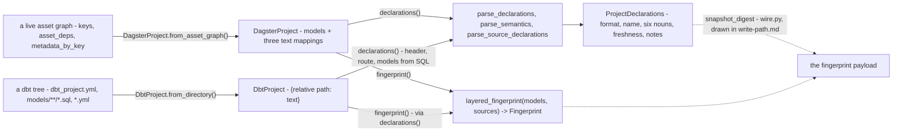

# The reduction side - from a source of truth to one declaration snapshot, and the adapter that proposes against it

- **Status:** living
- **Describes:** `src/crosslink/project.py`, `src/crosslink/dbt.py`,
  `src/crosslink/declarations.py`, `src/crosslink/context.py`,
  `src/crosslink/model.py`, the seam they satisfy in
  `src/crosslink/protocol.py`, the contract that checks them in
  `src/crosslink/conformance.py`, the formats built to fail it in
  `src/crosslink/conformance_calibration.py`, and the model-backed proposer
  at the bottom of `src/crosslink/generate.py` (`render_request`,
  `claude_proposer`, `GenerationError`)
- **Reviewed:** 2026-11-10 - the passages that cited a decision recorded
  outside this repository, or a commit, an issue or a pull request; the
  line citations into `__init__.py`, `context.py` and `wire.py`, each
  against the module; and the tier-1 table, counted against
  `ProjectSourceContract`: it names all eighteen arms. Nothing else
  re-read.

A design document, as `docs/design/README.md` defines one: it **describes
and never decides**. Every
decision it touches cites the record that made it - a bare `ADR-NNNN` below
is this corpus's; nothing is settled by
appearing here. It exists because the read side is stated nowhere else as a
shape: the
reduction is what `write-path.md`'s first box (`ProjectTree.reduce()`) hands
downstream, and adding a third format needs the reduction shape and the
conformance contract, which no other document holds.

## What decided this shape

- **ADR-0001** - the seam is tiered and a tier is *checked*, never claimed:
  a format implements the tiers it can serve and does not implement the
  rest, and `isinstance` against a nested protocol is what says which.
- **ADR-0002** - a proposal is made against code, never the declarative
  layer. On the read side that decides *direction*: the reduction reads a
  source of truth and never writes one, and the Dagster format stops at
  tier 2 because its truth is regenerated from elsewhere.
- **ADR-0003** - a proposal is verified against the reduction it claims to
  change. The reduction is therefore the oracle's eyes, and what it cannot
  see is the oracle's blind spot (`write-path.md`, "What the oracle can
  say"); this document says what it sees.
- **ADR-0004** - the first wire payload is a fingerprint. The fingerprint
  *itself* is this side's to compute (`model.py`); the payload and envelope
  are drawn in `write-path.md`.
- `src/crosslink/PROVENANCE.md` - the read side shares its origin with the
  public `dagster-dex` and depends on it nowhere; `dex.py`, that package's
  mapping onto an engine's model, is deliberately not here.
- One rule the modules carry and no record states: a conflicting duplicate
  identity is settled at the producer, never left to surface at diff time.
  Both formats and both parsers carry it; where each does is anchored below.

## The neutral model, and its four departures

`model.py` is the vocabulary every format reduces *to*. Its module docstring
(l.3-35) names four departures from the dbt-shaped model it could have
reused, each a decision the code carries rather than makes:

| departure | where it lands | what it refuses |
| --- | --- | --- |
| a key is always a tuple of columns | `DeclaredKey.columns` (l.248-258); `is_composite` is `len > 1` | a single-column grain as a different kind of thing |
| there is no project directory | `ProjectDeclarations` has `format` and `name` and no path (l.408-417); `context.py` holds the construction question instead | a path-free format carrying an empty or misleading field |
| freshness is a tri-state | `Freshness.NOT_APPLICABLE` (l.71-87) | "nothing to be stale about" reading as "checked, current" |
| a required field is a refusal to invent | `ExternalSource.system` required, `__post_init__` raises (l.145-155) | a fabricated source system indistinguishable from a declared one |

The snapshot is `ProjectDeclarations` (l.398-438): `format`, `name`, six
declaration nouns - `models`, `sources`, `declared_keys`, `declared_joins`,
`semantic_models`, `metrics` - plus `freshness` and `notes`. `is_empty`
counts sources (l.419-435): a project that builds nothing but names what it
reads has said something. `notes` is the one channel by which a reduction
degrades *with a reason* rather than raising; every "never raises" claim
below is honoured through it.

Three predicates are shared symbols on purpose, so the notes channel and the
findings layer cannot answer the same question differently:
`absent_join_sides` (l.193-205), `dangling_declaration_names` (l.208-223),
`unknown_reader_names` (l.226-236). `source_identity` (l.165-176) is what
makes two source declarations the same source - `(system, schema_name,
table)`, *not* `identifier`, which omits the schema - and `source_sort_key`
(l.179-190) is the one canonical order for a source collection, `None`-safe.
Each docstring names the disagreement that put it there.

## Two formats, one snapshot

Drawn from the signatures, READ. Both constructors take plain
data; the one method per format that touches the world is a classmethod, and
importing either module imports no orchestrator and no dbt.

### The asset-graph format (`project.py`)

`DagsterProject` (l.74) reaches tier 2 and stops. `propose_edits` is
**absent rather than present-and-refusing** (l.78-80), so
`isinstance(project, EditableProject)` is `False` and a caller finds out by
asking - ADR-0001's consequence, and ADR-0002's reason: the source of truth
is the Python that builds the graph, so an edit to the reduction would be
overwritten on the next run (l.5-9).

**Construction is duck-typed.** `from_asset_graph` (l.199-270) reads three
attributes named structurally in two unexported protocols, `_AssetKey`
(l.43-48, one attribute: `path`) and `_AssetDefinition` (l.51-68: `keys`,
`asset_deps`, `metadata_by_key`). Nothing imports the orchestrator - the
package docstring (`__init__.py` l.5-9) says so. The reduction is: model name = the key's last path segment
(l.256); `depends_on` = the parents' last segments, sorted (l.257-259);
`layer` = `metadata["layer"]`, lower-cased, or `None` (l.253, 260).

**Duplicates are refused against the raw definitions, case-folded, before
any graph is built** (l.237-246). The docstring (l.215-226) gives both
halves of the reason: `AssetGraph.from_assets` collapses two definitions
sharing a key into one node without complaint, so a check after the graph
exists can never fire; and downstream consumers key models by name, so two
names differing only in case collide on a case-insensitive filesystem,
silently dropping one. It is an *error* rather than a note because one of
the two models is about to disappear and every declaration keyed by that
name would attach to whichever survived. The constructor repeats the same
refusal (l.94-108) so a project built from plain data cannot
carry what `from_asset_graph` would have refused.

**What the graph cannot supply is declared.** Three text mappings ride
beside the models: `declaration_sources` (the schema-test vocabulary: keys
and joins), `semantic_sources` (semantic models and metrics) and
`source_declarations`, keyed by the *reading model* rather than by file path
(l.113-117). `ExternalSource`'s docstring (`model.py` l.119-125) is the
reason: a node that reads a warehouse table in its own SQL has no edge to
draw, so the read is invisible to any graph traversal and has to be stated.
`from_asset_graph` passes the mapping through untouched (l.228-232).

**`declarations()` never raises** (l.121-179). It runs the three parsers,
gathers their notes, then adds two of its own: declarations naming models
the graph does not build (kept, with a note - dropping them would hide the
likelier cause, a renamed or removed asset, l.129-132 and l.144-150) and
sources attributed to readers the graph does not build (l.152-163, named
apart because the cause differs). `freshness` is `NOT_APPLICABLE` because
there is no compiled artifact between the graph and the reduction to fall
out of date (l.174-177).

**`fingerprint()`** (l.183-194) parses the source declarations and calls the
shared `layered_fingerprint` - every decision about what a layer's hash
covers lives there, once.

### The dbt format (`dbt.py`)

`DbtProject` (l.104) is the second format and, per its module docstring
(l.5-10), the reason the seam is a seam: with one format the protocol
describes one implementation and the conformance suite discriminates
between no two formats. It takes `{relative path: text}` (l.116-122, backslashes
normalised to forward slashes so a tree built on Windows reads identically);
`from_directory` (l.232-271) is the only thing that touches a disk, and an
unreadable file becomes a walk note surfaced by `declarations()` rather than
a raise (l.245-252). It stops at tier 2 for a different reason than the
asset-graph format does: its class docstring (l.104-112) says the source of
truth here is files that can genuinely receive an edit, which makes it the
write path's first real target *later*, and `propose_edits` stays absent
until that work exists so `tier_of` answers 2 honestly. The Dagster absence
is structural; this one is provisional.

Three decisions its docstring states rather than absorbs (l.19-42):

- **References are extracted, not evaluated** - `ref()` and `source()` by
  regex over the SQL (`_REF_CALL` l.89-95, `_SOURCE_CALL` l.96-98), no Jinja
  engine, no dbt dependency. A call inside a SQL comment still renders and
  *is* a dependency, so it matches; a Jinja comment `{# ... #}` never renders,
  so it is stripped first (`_JINJA_COMMENT`, l.88, applied at l.400 and
  l.417). An expression the regex cannot read yields a missing edge, never a
  guessed one.
- **Freshness is `NOT_APPLICABLE` about this reduction, not about dbt** -
  dbt compiles a manifest that could be fresh or stale, but this reduction
  does not read it, so freshness of an artifact it never consulted would be
  a claim nobody checked (l.28-34, l.215).
- **`read_by` is derived, never declared** - a model that reads a source
  says so in its own SQL, so attribution comes from `source()` extraction
  over the *kept* models' files only (l.145-159, `_readers_by_table`
  l.412-420), and the "read by models that do not exist" note the Dagster
  format needs has no dbt equivalent (l.36-42).

The walk in pieces: `_project_header` (l.275-308) reads `dbt_project.yml`
and falls back to the name `"unnamed"` and `("models",)` with a note on every
failure shape (missing, unreadable, not a mapping, no name);
`_normalized_model_paths` (l.434-486) is the one reading of `model-paths`,
shared with the disk walk so the two cannot decide differently, normalising
`./models` and `models/` and dropping absolute entries with a note; `_route`
(l.310-365) sorts files under the model paths into the parsers' channels **by
top-level key**, so one schema file carrying `models:` beside `sources:`
feeds two parsers, and a file declaring none of the four vocabularies is
noted; `_models_from_sql` (l.367-410) makes one model per SQL file - name
from the stem, dependencies from `ref()`, layer from the first directory
under the model path (`_layer_of`, l.423-431) - and on a **duplicate stem
keeps the first in path order with a note** (l.394-399), the converge-and-
note posture rather than the Dagster format's refusal, because dbt itself
refuses duplicates at compile time and a read path cannot.

One shape is surfaced twice, deliberately (l.161-194): a `source()` read no
declaration covers is a note *and* a lineage edge on the reading model by
bare table name, because the SQL states the read and dropping it would hide
the "graph reads something nothing declares" contradiction in exactly this
format - parity with the Dagster reduction, which surfaces the same class as
a `depends_on` entry, is the findings layer's stated test.

### The parsers (`declarations.py`)

Three functions, one posture: **nothing here raises on bad input** (l.12-15).
A file that cannot be read, or says something contradictory, produces a note
and is skipped, because refusing to describe a project over one malformed
file among many turns an authoring typo into an outage on a read path. The
vocabulary is dbt's schema-test vocabulary (`unique`, `not_null`,
`relationships`, `unique_combination_of_columns`) because that is what the
declarations were already written in; it is an *input format*, not the
model (l.5-10 name the first three; `unique_combination_of_columns` is the
model-level composite key, `_composite_key`, l.137 and l.140).

- `parse_declarations` (l.84-133): keys and joins. A model-level
  `unique_combination_of_columns` and a column-level `unique` are two
  statements of the same grain; when both appear **the composite wins and the
  loss is a note** (l.117-131). `relationships` becomes a `DeclaredJoin` whose
  target is resolved by `_referenced_model` (l.47-62): `ref('x')`, the
  two-argument form (model second, the same reading `dbt.py`'s regex
  applies), or a bare alphanumeric name; anything with punctuation is
  refused with a note rather than half-parsed.
- `parse_source_declarations` (l.195-291): keyed by the reading model. Two
  models declaring the same table **converge on one source with two readers**
  (l.207-211, l.263-276) - emitting it twice would be reported as two
  contracts with the warehouse; columns are unioned in first-seen order
  because a narrower list is a narrower statement, not a contradiction. A
  file that parsed but declared no table is the failure worth naming
  (l.278-285): it reads as "this model has no external reads", a claim
  indistinguishable from having no file. The result is sorted by
  `source_sort_key`, never the raw identity triple, because the triple holds
  `str | None` and sorting it is a `TypeError` on valid input (l.287-291).
- `parse_semantics` (l.294-367): semantic models and metrics, each carrying
  a `definition_sha` over a sorted re-dump of its entry (l.333, l.356). The
  duplicate rule is carried here (l.299-304): the same name with
  identical content is one statement; with different content **the first
  declaration wins and the loss is a note**, so a snapshot this parser emits
  never carries the conflict the delta layer would otherwise refuse far from
  its cause.

### The construction question (`context.py`)

`protocol.py` states as a non-goal that it does not describe how a project is
*constructed* (l.30-34 of that file). `ProjectContext` (`context.py`
l.32-61) is that missing half: two fields, `repo_root` (or `None` when no
repository is in the picture) and `options` (the format's own non-secret
coordinates, passed through verbatim), because the formats disagree about
what keys them - a directory, a graph already in memory, a service - and the
disagreement does not resolve by picking whichever the first format used. Its
docstring carries two rules: refuse an option you cannot honour rather than
accept and ignore it, and **no secret arrives here**, since a format named in
committed configuration is named in a committed file. The module docstring
(l.16-20) names why this is the load-bearing question for the project: a
format resolved by name against a context is addressable from another
process; one built only from constructor arguments is a library object.
Read, and found none: `git grep -l ProjectContext -- '*.py'` returns only
`context.py` and `__init__.py`. Neither format's constructor
takes a `ProjectContext`, so the contract is stated ahead of its consumer.

## The seam, and the contract that checks it

`protocol.py` (l.52-137) nests three `runtime_checkable` protocols -
`ProjectSource` (`declarations()`), `FingerprintedProject` (`+ fingerprint()`),
`EditableProject` (`+ propose_edits()`) - and `tier_of` tests from the most
specific down (l.123-137). Tiers rather than capability flags because a flag
is a claim the engine has to trust and a tier is checkable (l.18-23) -
ADR-0001, whose own text says the design predates it. The tier-1
contract is behavioural: `declarations()` **must not raise** (l.63-73), and a
shape check cannot catch a format that gets it wrong.

`conformance.py` ships that behavioural half as an importable contract,
inside the package so an implementer outside it can run it (l.5-8). Subclass
`FingerprintedProjectContract` and implement `make_project(declarations,
semantics, sources)` (l.197-208); every arm runs. What the arms assert, READ:

| arm (tier 1, `ProjectSourceContract`, l.188-392) | the failure it exists for |
| --- | --- |
| `test_satisfies_the_tier_one_protocol`, `test_declares_a_stable_format_name` | shape, and a `format` a registry could resolve |
| `test_an_empty_project_never_raises`, `test_malformed_input_never_raises`, `test_malformed_input_is_explained_rather_than_silent` | raising on absent or malformed input, or degrading with no note (l.29-33: "the property a second implementation is most likely to get wrong") |
| `test_a_malformed_source_declaration_never_raises_and_is_explained` | the same on the *other* parser - one test over both would pass on either (l.246-248) |
| `test_a_single_column_key_is_read` | a one-column key not read, or read as anything but its one column (l.258-263) |
| `test_a_composite_key_keeps_every_column_and_their_order` | a truncated key that still looks like a declared grain; the fixture is four columns so pair-special-casing fails it (l.89-94) |
| `test_a_declared_join_carries_both_sides` | a declared join read with a side or its columns missing (l.278-285) |
| `test_a_dangling_join_side_is_agreed_by_notes_and_findings` | the notes channel and the findings layer disagreeing about the same snapshot - the tripwire for `absent_join_sides` (l.287-299) |
| `test_semantic_models_and_metrics_are_read` | semantic models and metrics declared and not read (l.301-306) |
| `test_an_external_source_is_read_and_attributed_to_its_reader` | a source read without its system, schema, table, columns or the model that reads it (l.310-320) |
| `test_a_source_requires_a_system_it_cannot_invent` | a placeholder system producing a finding about a table that does not exist under that name |
| `test_mixed_schema_presence_under_one_system_never_raises` | the `None`/`str` sort crash on valid input; asserts the canonical order (unschema'd first) so no format re-decides it inline |
| `test_one_table_declared_twice_is_one_source_with_two_readers`, `test_a_project_that_only_declares_sources_is_not_empty` | double-counted contracts; sources not counting as a statement |
| `test_the_declared_channel_is_not_vacuous` | the builders producing nothing while every arm above still passes (l.374-386) |
| `test_freshness_is_never_a_bare_boolean` | "current" where the honest answer is "not applicable" |

| arm (tier 2, `FingerprintedProjectContract`, l.395-437) | the failure it exists for |
| --- | --- |
| `test_satisfies_the_tier_two_protocol`, `test_a_fingerprint_is_stable_across_calls`, `test_fingerprinting_never_raises_on_an_empty_project` | an unstable or raising fingerprint |
| `test_two_identical_projects_fingerprint_alike` | two identical projects reading as drift |
| `test_gaining_an_external_source_is_visible_as_drift` | a new warehouse dependency reading as no change on the one axis a snapshot exists to watch |
| `test_repointing_a_source_to_another_schema_is_drift` | a hash over the bare table name calling a dataset swap no change (l.427-429: "the change most likely to be made by accident") |

The contract's `make_project` **takes three arguments, and the third is not
optional**: external sources are a required part of the contract,
deliberately, and not an optional side-door that would let the source
assertions go quietly unrun (l.22-27): a skip is not a signal. Once depended on, the arm
names are public surface (l.35-37).

Which format passes is a value the suite returns, not a claim this file
makes: `tests/test_conformance.py` l.26 and l.37 subclass the tier-2
contract for `DagsterProject` and `DbtProject`. The dbt adapter's docstring
(l.38-49) is worth reading for how the *derived* `read_by` meets a contract
keyed by a *declared* reader: it generates a reader model per channel key
whose SQL `source()`-references every table its file declares, so
attribution is genuinely derived by the format rather than replayed from
the test's key. The negative arm ships beside the contract:
`conformance_calibration.py` holds stand-in formats that refuse malformed
input, swallow it silently, or fingerprint unstably, each wrapping a real
`DagsterProject`, and `tests/test_conformance_calibration.py` asserts that
each fails the *named* arms and no others, as `write-path.md` describes ("The
seam the path hangs off").

## What the fingerprint sees, and what it cannot

`Fingerprint` (`model.py` l.307-335) is `layers: {layer name: hash}` plus
`models: tuple[str, ...]`. Per layer rather than one hash because a single
hash answers "did anything change" and nothing else, and the useful question
on a drift report is *which part* (l.316-318). `changed_layers` (l.324-335)
returns every layer whose hash differs **including layers present on one side
only** - treating a missing layer as unchanged is how a deleted one disappears
from a drift report entirely.

`layered_fingerprint(models, sources)` (l.338-395) is the house shape, shared
by both formats so what a layer's hash covers is decided once. Its inputs,
READ from the code:

- Models group by `layer or "unassigned"` (l.372). Each layer's hash is over
  `name(dep,dep,...)` lines, models sorted by name (l.374-382) - so
  **dependencies are in the hash**: a rewiring that moves no model between
  layers still changes what the layer computes.
- When any source is declared, a `"sources"` entry hashes
  `system.schema.table` lines in canonical order (l.384-393); **omitted
  entirely when no sources are declared**, so a project that declares none
  fingerprints over its model layers alone. A real layer literally
  named `"sources"` has its hash *combined* with the source hash, not
  overwritten (l.391-392); a layer literally named `"unassigned"` is
  indistinguishable from the layerless by construction - both caveats travel
  with the function (l.360-366).

**Four of the six nouns are outside every layer hash.** `declared_keys`,
`declared_joins`, `semantic_models` and `metrics` are not inputs to
`layered_fingerprint`; only `models` (name, dependencies, layer) and `sources`
(identity) are. A key widened, a join re-pointed, a metric's measure changed -
none moves any layer's hash. That is why the wire payload carries a second
digest beside the layers: `snapshot_digest` (`wire.py` l.144-167) hashes the
canonicalised snapshot over `format`, `name` and **all six nouns**, with
`freshness` and `notes` on a drop-list so a noun added to
`ProjectDeclarations` joins the digest by default - "the defect this digest
exists to cure in the layered fingerprint", in its own words. The comparer
then reports a change the layers cannot see as `DRIFT` with **empty**
`changed_layers` and `digest_changed=True` - the digest-only shape
`write-path.md` draws and ADR-0004 prices. This document's contribution is
the input list: what reaches a layer hash is exactly the two collections
named above, and nothing else.

Two more things the reduction does not see, stated in the modules and
carried here: **column-level anything** except a source's declared column
names (`ExternalSource.columns`, unioned, and not part of any hash), and
**declaration text the parsers ignore** - a `not_null` test, a description,
a tag. ADR-0003 prices that as the oracle's structural blind spot; the
target project's own suite is the second verifier.

## The proposer adapter

Everything from `generate.py` l.299 down is **one adapter behind the
`Proposer` seam** (l.220: `Callable[[ProposalRequest], TreeEdit]`), and the
loop above it is proven on hand-written proposers with no network anywhere
near it (module docstring l.18-24; the loop itself is drawn in
`write-path.md`, "The search, as a sequence"). This section describes only
the adapter.

Where it sits in the reduction's terms: a `ProposalRequest` (l.203-215)
carries the `ProjectTree` - the plain-data inputs `DagsterProject` is
constructed from (`verify.py` l.63-83), so the proposer edits **the inputs to
the reduction, never the reduction** (ADR-0002) - the stated `Delta`, and
every refused `Attempt` so far. A `TreeEdit` (l.84-175) is per-entry
set-or-remove over the tree's models and its three text mappings, and
`apply` compiles it to a `Patch` so the oracle judges a model's proposal by
exactly the machinery that judged hand-written ones.

Three pieces, and what each may not do:

- **`render_request`** (l.433-479) is pure. It renders the tree entry by
  entry with declaration text verbatim (because the edit must reproduce what
  it does not change), the stated delta by its dataclass repr, and each
  refused attempt with the oracle's stated-versus-observed disagreement per
  noun or the sandbox's error. It renders **everything the request carries
  and nothing else** - a proposer that needed more would be reading state
  the oracle does not judge by (l.208-210).
- **The reply is schema-constrained, then re-validated.** `_EDIT_SCHEMA`
  (l.344-367) states the exact shape with `additionalProperties` refused
  everywhere; entries are `{key, value}` pairs rather than objects so the
  schema can say so (l.325-330). `_edit_from_json` (l.393-421) then holds
  the house duplicate doctrine the schema cannot - an identical restatement
  collapses, the same key with different values refuses (`_entries`,
  l.381-390) - and every model value passes through `ProjectModel`'s own
  constructor: **a proposal does not get a laxer constructor than a
  producer** (l.400-403).
- **`claude_proposer`** (l.482-525) takes an injectable client shaped like
  the SDK's; when omitted, `anthropic` is imported **here and only here**
  (l.505-508) - the `generate` optional extra, the `generate` entry under
  `pyproject.toml`'s `[project.optional-dependencies]`, which says the
  coupling a package declares should be exactly the coupling its code has - and the client resolves credentials from the operator's
  environment: the adapter **borrows the ambient identity per call and holds
  nothing**, the delivery adapter's discipline at the other end of the loop
  (l.493-497). The returned proposer raises `GenerationError` (l.77-80) when
  the channel fails - a response that stopped for a refusal or the token
  ceiling produced no proposal (l.517-521) - and that error is reserved for
  the channel, never for the search failing, which is a `Generation` that
  does not close, or the input being wrong, which is a `ValueError`.

Defaults READ: `model="claude-opus-5"`, `max_tokens=16000`
(l.485-486). The system prompt (`_SYSTEM`, l.369-378) tells the model that
an edit doing more than the delta states is refused even if the extra work
looks like an improvement - the oracle's "closes means equals" rule, stated
to the searcher in advance. Not read: any calibration run of this adapter
against a live model. The suite exercises it with a duck-typed stand-in
(l.301-307); the roadmap's step 5 says "if the model disappoints, the system
still accepts human patches and proves they did what was intended".

## Sharp edges a reader should carry

- **Two formats refuse duplicates differently, and both are right.** A
  duplicate model name is an *error* in the Dagster format (one model is
  about to disappear, and the graph never had a compile step to catch it)
  and a *note* in the dbt format (dbt refuses it at compile time; a read
  path keeps the first and says so). The two differ on whether the source of
  truth can already carry the collision: dbt's compile step does, a graph has
  none.
- **A layer is the format's business.** Medallion tier from asset metadata
  in one format, first directory under `model-paths` in the other; the
  comparer only needs a format to compute it the same way twice. Two formats
  are not required to fingerprint alike, and the shared symbol exists to
  stop a drift channel, not to promise cross-format equality (`model.py`
  l.341-346).
- **`"sources"` and `"unassigned"` are reserved by collision, not by rule.**
  A model layer with either name changes what the fingerprint means without
  anything refusing it; the caveat lives on `layered_fingerprint` and
  nowhere else.
- **`context.py` has no caller yet** (read, not assumed: the grep above).
  The construction contract is stated ahead of the first format that takes
  it; the first format that resolves by name is the first consumer of this
  contract.
- **The proposer edits inputs, the oracle reads outputs.** Nothing in the
  adapter may reach the reduction, the verdict, or a credential; it sees one
  rendered request and returns one edit.

When a claim above stops being true, the change that falsifies it edits this
document in the same pull request (`docs/design/README.md`). Every file this
document describes is in this repository.
