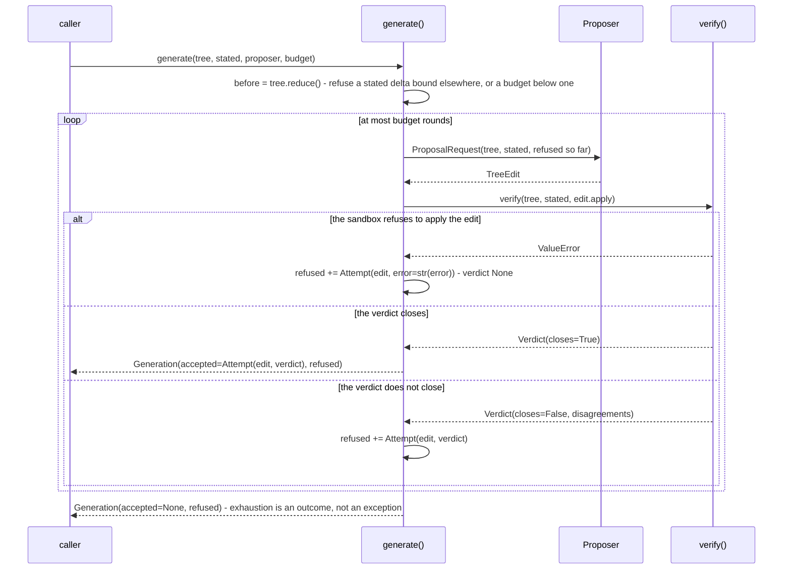
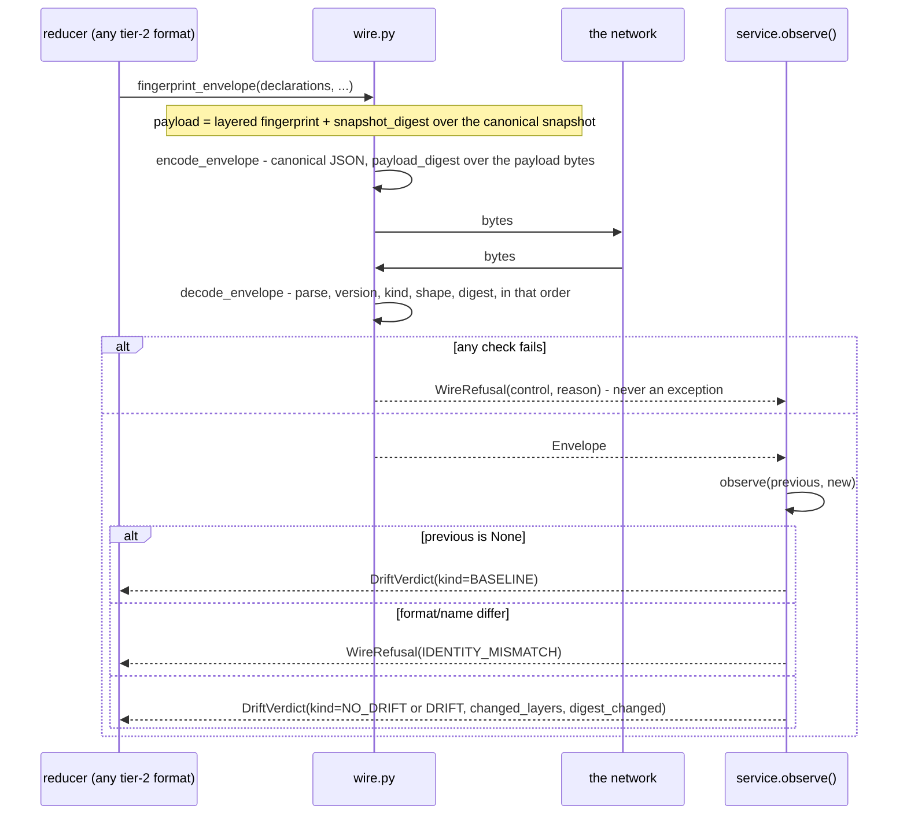
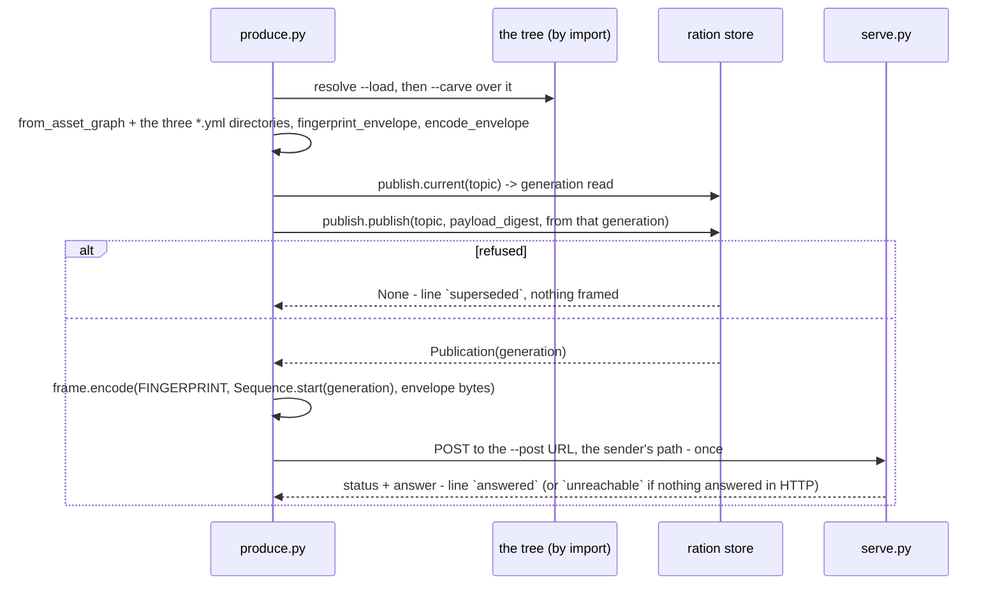

# The write path - from a reduction to a pull request, and the wire beside it

- **Status:** living
- **Describes:** `src/crosslink/findings.py`, `src/crosslink/delta.py`,
  `src/crosslink/verify.py`, `src/crosslink/generate.py`,
  `src/crosslink/deliver.py`, `src/crosslink/wire.py`,
  `src/crosslink/service.py`, `src/crosslink/serve.py`,
  `src/crosslink/produce.py`, and the seam they hang off,
  `src/crosslink/protocol.py`
- **Reviewed:** 2026-11-11 - the table in *What the oracle can say*, row by
  row, against `verify()` in `src/crosslink/verify.py` and `generate()` in
  `src/crosslink/generate.py`, and the tier table in *The seam the path
  hangs off* with the sentence under it, against `src/crosslink/protocol.py`
  and the two tests the section names, all at `e3255f0`. Nothing else
  re-read.

A design document, as `docs/design/README.md` defines one: it **describes
and never decides**. Every
decision it touches cites the record that made it - a bare `ADR-NNNN` below
is this corpus's - or the roadmap section that states it; nothing is
settled by appearing here. It exists because the write path is built,
proven, and stated nowhere else as a shape: the sequencing lives in one
roadmap list and the types that flow between steps in the modules'
docstrings.

## What decided this shape

- **ADR-0001** - the seam is tiered and a tier is *checked*, never claimed:
  `isinstance` against a nested protocol, so a format that cannot receive
  edits cannot say it can.
- **ADR-0002** - a proposal is made against code, never the declarative
  layer: the reduction is regenerated, so the patch lands in the tree and its
  *effect* is stated over declarations.
- **ADR-0003** - a proposal is verified against the reduction it claims to
  change: the intended effect is a delta stated in advance, and a patch is
  accepted only when sandbox-apply, rebuild and re-reduce close it. The
  mechanism fixed the order the roadmap builds in.
- **ADR-0004** - the first wire payload is a fingerprint, in a versioned
  envelope, to a service that only reads and compares.
- `docs/ROADMAP.md` carries three decisions this document leans on:
  authority 1 (self-consistency) ships alone; the deliverer borrows and
  never holds; the wire layer lives in this repository.

## The pipeline, as the types that cross it

Drawn from the signatures of `findings()`, `diff()`, `verify()`,
`generate()`, `deliver_pull_request()` and `emit_files()`, READ. Each arrow is
labelled with the function that turns one type into the next, so the picture
greps.

```mermaid
flowchart LR
    T["ProjectTree - the sandbox subject"] -->|"reduce()"| C["ProjectDeclarations - C"]
    C -->|"findings()"| F["Finding - kind, subject, claim, exactly two evidence sites"]
    F -->|"proposal, when statable without invention"| D["Delta - the stated delta, bound to one format/name"]
    D --> G["generate(tree, stated, proposer, budget)"]
    G -->|"each round: ProposalRequest(tree, stated, refused)"| P["Proposer - a callable, never a client"]
    P -->|"TreeEdit.apply, a Patch"| V["verify(tree, stated, patch) -> Verdict"]
    V -->|"closes"| A["Generation.accepted - one Attempt carrying its Verdict"]
    V -->|"refused, or the sandbox raised"| R["Generation.refused - the trace, in order"]
    R -.->|"fed back as ProposalRequest.refused"| P
    A --> PO["PatchObject - title, rationale, edits, a closing Verdict"]
    PO -->|"deliver_pull_request(patch, repository, open_pull_request)"| PR["Delivered - branch, base, commit, pull_request"]
    PO -->|"emit_files(patch, directory)"| FS["files on disk - the zero-authority floor"]
```



What each hop refuses, because the refusals are the design:

- **`findings()` proposes nothing rather than invent.** An undeclared lineage
  root has no proposal: the consistent edit would be an external source, and
  a source requires a system only a human knows. A finding without a proposal
  is still a finding (`findings.py`, module docstring).
- **`Delta` is bound to a project.** `diff` refuses to compare across
  projects, and every consumer downstream - `verify`, `generate` - refuses a
  delta whose `(format, name)` is not the one the tree reduces to, before
  doing any work: a verdict against the wrong subject is evidence about
  nothing.
- **`PatchObject` cannot be built from a refusing verdict.** The refusal is at
  construction, not delivery, so a proposal whose own evidence says it did not
  do what it claimed cannot be packaged. It also refuses a title or rationale
  that places a closing keyword before an issue reference - the two become a
  commit message the target's forge scans.
- **Delivery never overwrites.** A branch that exists, a non-empty emission
  directory, or an edit set already true in the target are each refused; a
  second delivery is a new decision. No parameter anywhere in `deliver.py`
  accepts a credential - the forge half is a callable the operator supplies
  per act.

## The search, as a sequence

Drawn from `generate()` (`generate.py`), READ. Symbols rather than numbers:
`budget` is the caller's, default three.



Three properties the sequence encodes, each stated in the module:

- **A crash is feedback here and only here.** `verify` lets a broken patch
  raise; the generator *is* whoever wrote the patch, so it records the
  sandbox's error verbatim on the attempt and the next round sees it. An
  `Attempt` records exactly one of verdict or error - checked where the value
  is made.
- **Anything the proposer itself raises propagates.** A broken channel is not
  a refused attempt; `GenerationError` is reserved for the model-backed
  proposer's channel failing, never for the search failing.
- **An exhausted search is evidence about the proposer.** `Generation` carries
  the full trace either way, which is what a calibration run reads.

## What the oracle can say

`verify()` reduces the tree as it stands, applies the patch to a *copy* - its
own mappings, so a patch that mutates in place cannot edit the caller's tree
on the way to a refusal - reduces again, and compares `diff(C, C')` with the
stated delta field by field, excluding the binding fields.

| Outcome | Shape | Meaning | What `generate` does with it |
| --- | --- | --- | --- |
| accepted | `Verdict(closes=True, disagreements=())` | the observed delta *equals* the stated one | ends the search, accepted |
| refused | `Verdict(closes=False, disagreements=(nouns...))` | the collections where observed and stated differ, named | records the attempt with its verdict; the next proposer sees the nouns |
| wrong subject | `ValueError` before any patch runs | the stated delta is bound to another project than the tree reduces to | never receives it from `verify`: `generate` makes the same check itself, before any proposal is requested, and raises `ValueError` to its caller; no attempt is recorded |
| renamed subject | `ValueError` from `diff(before, after)`, after the patch ran in the sandbox and the copy was re-reduced | the patch renamed the project, so `diff` refuses to compare across projects and the harness does not catch what it cannot interpret | does not meet it: `TreeEdit.apply` carries the tree's name through, so no proposal it judges renames the project. A `ValueError` reaching it from `verify` is recorded as an attempt with the error text and no verdict, and the search continues |
| the patch raises | propagates | a broken patch is not a refusal | (generate catches only `ValueError`; anything else propagates) |

**Closes means equals.** A patch that did more than it claimed in declaration
space did something nobody stated in advance, and accepting it would put the
surplus outside the mechanism (`verify.py`, module docstring). The known
consequence: a finding's proposal corrects one field in declaration space,
and the natural tree patch also drops the columns that declaration
contributed - the oracle observes a wider delta and refuses. That refusal is
the oracle being right; `findings.py` says so and the tests demonstrate it.

**The blind spot is structural, and priced.** The comparison sees exactly what
the reduction sees. A patch can close its delta while breaking something the
reduction does not model - declaration text the parser ignores, the compute
behind a model - and the harness accepts it. ADR-0003 names the target
project's own suite as the second, independent verifier; the oracle's
calibration - `TestTheBlindSpot` in `tests/test_verify.py` - demonstrates
the blind spot with a passing oracle and a failing stand-in suite rather
than describing it. `verify.py`'s module docstring calls that file "the
calibration suite"; `tests/test_conformance_calibration.py` is a different
file, and this document names the two apart.

## The seam the path hangs off

The tiers are protocols nested by inheritance, and `tier_of` tests from the
most specific down (`protocol.py`). Which format reaches which tier is a
value the suite returns, not a claim this file makes:

```python
from crosslink.protocol import tier_of
tier_of(DagsterProject(...))   # tests/test_project.py - the asset-graph format
tier_of(DbtProject(...))       # tests/test_dbt.py - the second format
```

| tier | contract | `DagsterProject` | `DbtProject` |
| --- | --- | --- | --- |
| 1 | `declarations()` - must not raise; a malformed input is explained | yes | yes |
| 2 | `+ fingerprint()` - stable across calls, drift visible | yes | yes |
| 3 | `+ propose_edits()` | no | no |

Both cells in the last row read `no` **by design** (ADR-0001's consequences):
a Dagster reduction rightly declines edits because its truth is the code that
builds the graph, and a dbt project is the natural first tier-3 candidate
because its truth is files that can receive one - which is why the second
format was scheduled ahead of any tier-3 work (`docs/ROADMAP.md`, "The second
format"). The behavioural half of each tier is enforced by the conformance
classes in `conformance.py` - `ProjectSourceContract` for tier 1,
`FingerprintedProjectContract` adding tier 2 - and the conformance
calibration holds the negative arm. Its stand-in formats, which refuse
malformed input, swallow it silently, or fingerprint unstably, ship beside
the contract in `conformance_calibration.py`, and
`tests/test_conformance_calibration.py` asserts that each fails the *named*
arms and no others.

## The wire, as a sequence

Drawn from `wire.py` and `service.py`, READ. The codec decides
what an envelope *is*; the comparer decides what a service *does* with two of
them; they are separate modules on purpose because syntax and semantics
evolve on different clocks - ADR-0004's consequences, which put the
compare/decide half beside the codec and not inside it, and which the
modules carry rather than decide.



The decode ladder is a contract a future version leans on - **version before
shape**, so a v2 envelope with a different shape refuses as
`unknown-schema-version` rather than as malformed. That is ADR-0004's
decision, not the module's: later payloads are new payload kinds inside this
envelope, and the schema version moves only when the envelope's own shape
does; the comment above `WIRE_SCHEMA_VERSION` restates it. The controls are a
closed set: `unknown-schema-version`, `unknown-payload-kind`,
`malformed-envelope`, `digest-mismatch` - read them with
`grep -n '^[A-Z_]* = "' src/crosslink/wire.py`, which lists five string
constants; the four beneath the "closed control set" comment are the
controls, and `FINGERPRINT_KIND` above it is a payload kind, not a control.
`identity-mismatch` is deliberately *not* a decode control: each envelope in
a mismatched pair is individually valid, so only the code that sees the pair
can refuse the pairing, and the comparer owns it.

The verdict has three kinds and one load-bearing shape - the same grep over
`src/crosslink/service.py` lists four string constants: the three kinds, and
`IDENTITY_MISMATCH`, the comparer's one refusal control. `BASELINE` is its own
kind because "nothing to compare against" and "compared, and nothing moved"
are different statements. `DRIFT` with **empty** `changed_layers` and
`digest_changed=True` is the shape the payload's redundancy exists for: the
layered fingerprint covers models and sources only, so a change in the four
nouns it cannot see - keys, joins, semantic models, metrics - surfaces as
undifferentiated drift rather than being folded into `NO_DRIFT`. ADR-0004
prices that redundancy; the comparer honours it by never letting the two
answers disagree silently.

## The comparer as a process

Drawn from `serve.py`, READ. `service.observe` decides; `serve.py`
is the process around it, and the process is where the frame enters. The
fingerprint crosses inside a `ration` frame, and the frame is checked before
the payload. That the v1 service
only reads and compares, holds no credential and mints no identity is
ADR-0004's decision, which the module carries. Where the process runs and
what owns its lifecycle are its deployment's to decide, and the module
decides neither.

A `POST /<sender>` is judged in three layers, in this order, and the order
is the contract: the **frame** (`ration.frame`, decoded against the sender's
`SequenceLedger` before anything reads the body; a refusal answers 400), the
**envelope** (`decode_envelope` on the frame's body; 422), the **comparer**
(`observe` against the standing objective; `identity-mismatch` answers 422,
a verdict 200). Every request leaves exactly one JSON line on stdout, and
the line carries `layer` as a field of its own beside `control` - so a
`crc-mismatch` and a `digest-mismatch` differ in two fields and cannot land
as one signal in the log, and `unknown-payload-kind`,
the one control name all three layers use, is told apart by `layer` alone.
Three controls are the process's own, decided before a body is read:
`unknown-sender` (the set of senders is the caller's, so a stranger cannot
allocate ledgers), `length-required` and `body-too-large`.

The standing objective is the last **accepted** envelope, kept as the bytes
that arrived and written to `--baseline` before the verdict is answered, so
that a restart starts from the objective it had and the first request after
it is a `no-drift`, not a `baseline`. A refused request never touches it. A
comparer that could not keep it refuses to start rather than failing at its
first verdict: a baseline that does not decode, a baseline directory that does
not exist, and one this process cannot write in, the last found by making the
verdict's own first write and removing it.
The ledgers are memory only - a restart forgets them, the cost
`ration.frame`'s docstring states and `serve.py`'s own docstring prices - and
that forgetting is also the by-hand clear for the epoch hazard: a store that
loses its data restarts the producer's epoch below what the ledger accepted.
One refusal moves state and is stated as such: a frame of a
registered kind the comparer does not serve has passed every frame check, so
its sequence is consumed.

## The producer as a process

Drawn from `produce.py`, READ. It is the comparer's sender: one run
reduces a graph, publishes, frames and posts, and writes one JSON line -
none when its store cannot be used, which raises, as `ration`'s `publish.py` raises
it. The
producer is this repository's module and runs beside the tree it reduces,
not as a step of that tree's own job: the tree is named by `--load` and
`--carve`, as arguments, and nothing here imports it. Its epoch is a
publication generation, read from the store. The carve is the reduced
tree's own rule, applied by that tree's function. Where a producer runs,
and on what cadence, is its deployment's to decide; the module decides
neither.



The epoch is what makes an infrequent sender safe to order without state:
the store's version is monotonic per key and never reused, so every run's
epoch is above every earlier run's, the comparer's ledger accepts it at count
zero, and a frame from any earlier run is `sequence-replayed`. That holds
while the store keeps its data: a store that loses it is the epoch hazard
named above, and its clear is the comparer's restart. Every run
publishes, an unchanged graph included, so the topic's generation advancing
with every run is a liveness signal. Nothing is retried: a refused publication is a
second writer, a topology fact, and an undelivered frame is superseded by
the next run's epoch. `RATION_DSN` unset refuses the run rather than disarming
it, because without a store there is no epoch to frame with; `--dry-run`
reduces without one.

## Sharp edges a reader should carry

- **The envelope carries no ordering claim.** No generation, no sequence, no
  fencing field: a consumer-trusted ordering claim is coordination state and
  belongs to the substrate, not the wire (`wire.py`, module docstring).
  `emitted_at` and `producer_version` exist for the log line; no reader may
  branch on them.
- **Canonical JSON is one call, including a default.** `sort_keys`,
  compact separators, `allow_nan=False`, *and* `ensure_ascii=True` by
  default - a second producer that copies the three named arguments and not
  the default emits a dialect.
- **A rename reads as drop-and-add.** Two snapshots record difference, not
  intent; ADR-0003 names this as the vocabulary's known falsifier, and the
  limit is stated in `delta.py` rather than solved there.
- **`observe` is pure.** No persistence, no leases, no held state - whoever
  calls it owns the previous envelope. The delta and proposal payload kinds
  are named in `service.py` as *not built early*; ADR-0004's consequences
  hold their gates. The long-lived process is `serve.py`, and it takes
  exactly the split the bullet's first sentence states: the process owns the
  previous envelope and the file it came from, and `observe` holds nothing.
- **Nothing here holds a credential, and nothing here names the tool.** The
  delivery adapter borrows the operator's ambient identity per act, and a
  rendered body carries the rationale and the evidence but no product
  identifier - the evidence is the signature. The producer uses one: it
  reads `RATION_DSN` from its environment per run and
  writes exactly one thing with it, the topic pointer - borrowed per act the
  way delivery borrows an identity, held nowhere, and never on the wire. The
  second half holds for it too: its request's `User-Agent` is `producer/1`,
  and the envelope names only `producer_version`.

When a claim above stops being true, the change that falsifies it edits this
document in the same pull request (`docs/design/README.md`). Every file this
document describes is in this repository.
