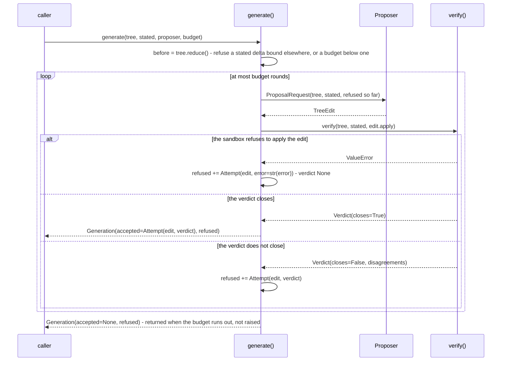
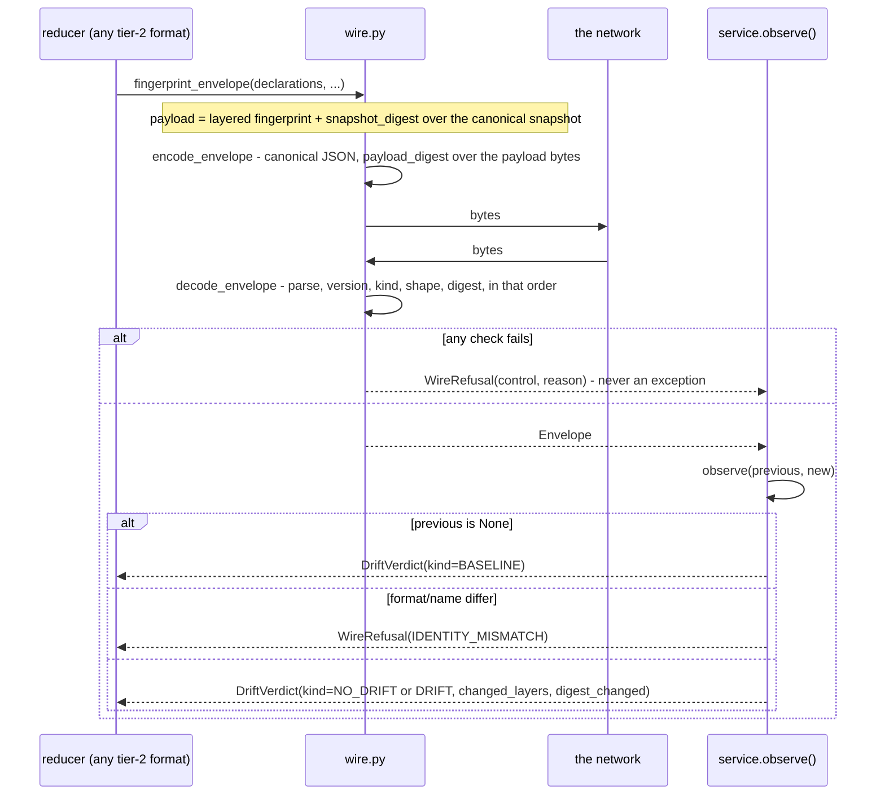
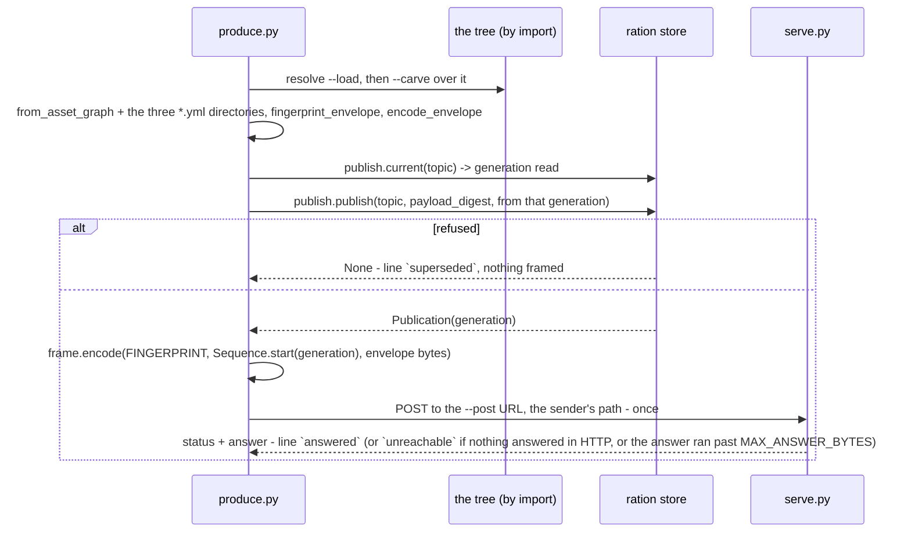

# The write path - from a reduction to a pull request, and the wire beside it

- **Status:** living
- **Describes:** `src/crosslink/findings.py`, `src/crosslink/delta.py`,
  `src/crosslink/verify.py`, `src/crosslink/generate.py`,
  `src/crosslink/deliver.py`, `src/crosslink/wire.py`,
  `src/crosslink/service.py`, `src/crosslink/serve.py`,
  `src/crosslink/produce.py`, and the seam they hang off,
  `src/crosslink/protocol.py`
- **Reviewed:** 2026-11-11 - the table in *What the oracle can say*, row by
  row, against `verify()` in `src/crosslink/verify.py` and `generate()` in
  `src/crosslink/generate.py`, and the tier table in *The seam the path
  hangs off* with the sentence under it, against `src/crosslink/protocol.py`
  and the two tests the section names, all at `e3255f0`. Nothing else
  re-read.

A design document, as `docs/design/README.md` defines one: it **describes
and never decides**. Every
decision it touches cites the record that made it - a bare `ADR-NNNN` below
is this corpus's - or the roadmap section that states it; nothing is
settled by appearing here. It exists because the write path is built,
proven, and stated nowhere else as a shape: the sequencing lives in one
roadmap list and the types that flow between steps in the modules'
docstrings.

## What decided this shape

- **ADR-0001** - the seam is tiered and a tier is *checked*, never claimed:
  `isinstance` against a nested protocol, so a format that cannot receive
  edits cannot say it can.
- **ADR-0002** - a proposal is made against code, never the declarative
  layer: the reduction is regenerated, so the patch lands in the tree and its
  *effect* is stated over declarations.
- **ADR-0003** - a proposal is verified against the reduction it claims to
  change: the intended effect is a delta stated in advance, and a patch is
  accepted only when sandbox-apply, rebuild and re-reduce close it. The
  mechanism fixed the order the roadmap builds in.
- **ADR-0004** - the first wire payload is a fingerprint, in a versioned
  envelope, to a service that only reads and compares.
- `docs/ROADMAP.md` carries three decisions this document leans on:
  authority 1 (self-consistency) ships alone; the deliverer borrows and
  never holds; the wire layer lives in this repository.

## The pipeline, as the types that cross it

Drawn from the signatures of `findings()`, `diff()`, `verify()`,
`generate()`, `deliver_pull_request()` and `emit_files()`, READ. Each arrow is
labelled with the function that turns one type into the next, so the picture
greps.

```mermaid
flowchart LR
    T["ProjectTree - the sandbox subject"] -->|"reduce()"| C["ProjectDeclarations - C"]
    C -->|"findings()"| F["Finding - kind, subject, claim, exactly two evidence sites"]
    F -->|"proposal, when statable without invention"| D["Delta - the stated delta, bound to one format/name"]
    D --> G["generate(tree, stated, proposer, budget)"]
    G -->|"each round: ProposalRequest(tree, stated, refused)"| P["Proposer - a callable, never a client"]
    P -->|"TreeEdit.apply, a Patch"| V["verify(tree, stated, patch) -> Verdict"]
    V -->|"closes"| A["Generation.accepted - one Attempt carrying its Verdict"]
    V -->|"refused, or the sandbox raised"| R["Generation.refused - the trace, in order"]
    R -.->|"fed back as ProposalRequest.refused"| P
    A --> PO["PatchObject - title, rationale, edits, a closing Verdict"]
    PO -->|"deliver_pull_request(patch, repository, open_pull_request)"| PR["Delivered - branch, base, commit, pull_request"]
    PO -->|"emit_files(patch, directory)"| FS["files on disk - the zero-authority floor"]
```



What each hop refuses, because the refusals are the design:

- **`findings()` proposes nothing rather than invent.** An undeclared lineage
  root is reported with no proposal attached (`findings.py`).
- **`Delta` is bound to a project.** `diff` will not compare two projects'
  snapshots, and every consumer downstream - `verify`, `generate` - refuses a
  delta whose `(format, name)` is not the one the tree reduces to, before
  doing any work: a verdict against the wrong subject is evidence about
  nothing.
- **`PatchObject` cannot be built from a refusing verdict.** The refusal is at
  construction, not delivery (`deliver.py`). It also refuses a title or rationale
  that places a closing keyword before an issue reference - the two become a
  commit message the target's forge scans.
- **Delivery never overwrites anything.** An existing branch, an emission
  directory with anything in it, and edits the target already holds are each
  refused. No parameter anywhere in `deliver.py` accepts a credential; the
  forge half arrives as a callable, per act.

## The search, as a sequence

Drawn from `generate()` (`generate.py`), READ. Symbols rather than numbers:
`budget` is the caller's, default three.



Three properties the sequence encodes, each stated in the module:

- **An edit the sandbox cannot apply becomes an attempt.** `verify` raises on
  it, and `generate` records the error text on the `Attempt`, with no
  verdict, for the next request to carry. An `Attempt` holds exactly one of a
  verdict or an error, checked where the value is made.
- **What the proposer raises is not caught.** It reaches the caller of
  `generate` and is never recorded as an attempt. `GenerationError` is the
  model-backed proposer's error for its own channel.
- **`Generation` carries the whole trace either way,** accepted or not: every
  refused attempt, in order.

## What the oracle can say

`verify()` reduces the tree as it stands, hands the patch a *copy* with
mappings of its own, so a patch that mutates in place cannot edit the caller's
tree on the way to a refusal, reduces the copy, and compares the diff of the
two reductions against the stated delta field by field, leaving out the
binding fields.

| Outcome | Shape | Meaning | What `generate` does with it |
| --- | --- | --- | --- |
| accepted | `Verdict(closes=True, disagreements=())` | observed and stated are *equal* | ends the search, accepted |
| refused | `Verdict(closes=False, disagreements=(nouns...))` | the collections where observed and stated differ, named | records the attempt with its verdict; the next proposer sees the nouns |
| wrong subject | `ValueError` before any patch runs | the stated delta names a different `(format, name)` from the tree's | never receives it from `verify`: `generate` makes the same check itself, before any proposal is requested, and raises `ValueError` to its caller; no attempt is recorded |
| renamed subject | `ValueError` from `diff(before, after)`, after the patch ran in the sandbox and the copy was re-reduced | the patch renamed the project; `diff` refuses a pair of snapshots from two projects, and `verify` lets that refusal through | does not meet it: `TreeEdit.apply` carries the tree's name through, so no proposal it judges renames the project. A `ValueError` reaching it from `verify` is recorded as an attempt with the error text and no verdict, and the search continues |
| the patch raises | propagates | the exception reaches the caller as raised | (generate catches only `ValueError`; anything else propagates) |

**Closes means equals** (`verify.py`): the verdict accepts only an observed
delta identical to the stated one. So a finding's proposal can be
refused by the oracle that judges it, when the natural tree patch moves more
than the one field the proposal states; `findings.py` describes the case, and
the tests show it.

**The blind spot is structural, and priced.** ADR-0003 prices it: the oracle
sees only what the reduction sees, and the target project's own suite is the
second, independent verifier. The test that shows it is
`tests/test_verify.py`'s `TestTheBlindSpot`, where the oracle accepts a patch
that a stand-in suite for the target project refuses. It is not
`tests/test_conformance_calibration.py`, which calibrates the conformance
contract, and this document names the two apart.

## The seam the path hangs off

The tiers are protocols nested by inheritance, and `tier_of` tests from the
most specific down (`protocol.py`). Which format reaches which tier is a
value the suite returns, not a claim this file makes:

```python
from crosslink.protocol import tier_of
tier_of(DagsterProject(...))   # tests/test_project.py - the asset-graph format
tier_of(DbtProject(...))       # tests/test_dbt.py - the second format
```

| tier | contract | `DagsterProject` | `DbtProject` |
| --- | --- | --- | --- |
| 1 | `declarations()` - must not raise; a malformed input is explained | yes | yes |
| 2 | `+ fingerprint()` - stable across calls, drift visible | yes | yes |
| 3 | `+ propose_edits()` | no | no |

Both cells in the last row read `no` **by design** (ADR-0001's consequences):
a Dagster reduction rightly declines edits because its truth is the code that
builds the graph, and a dbt project is the natural first tier-3 candidate
because its truth is files that can receive one - which is why the second
format was scheduled ahead of any tier-3 work (`docs/ROADMAP.md`, "The second
format"). The behavioural half of each tier is enforced by the conformance
classes in `conformance.py` - `ProjectSourceContract` for tier 1,
`FingerprintedProjectContract` adding tier 2 - and the conformance
calibration holds the negative arm. Its stand-in formats, which refuse
malformed input, swallow it silently, or fingerprint unstably, ship beside
the contract in `conformance_calibration.py`, and
`tests/test_conformance_calibration.py` asserts that each fails the *named*
arms and no others.

## The wire, as a sequence

Drawn from `wire.py` and `service.py`, READ. `wire.py` is the codec and
`service.py` the comparer: two modules, as ADR-0004's consequences place
them.



`decode_envelope` checks **version before shape**, so an envelope of a later
version refuses as `unknown-schema-version` whatever its shape. That later
payloads are new payload kinds inside this envelope, and that the schema
version moves only when the envelope's own shape does, is ADR-0004's
decision; the comment above `WIRE_SCHEMA_VERSION` restates it. The controls are a
closed set: `unknown-schema-version`, `unknown-payload-kind`,
`malformed-envelope`, `digest-mismatch` - read them with
`grep -n '^[A-Z_]* = "' src/crosslink/wire.py`, which lists five string
constants; the four beneath the "closed control set" comment are the
controls, and `FINGERPRINT_KIND` above it is a payload kind, not a control.
`identity-mismatch` is deliberately *not* a decode control: each envelope in
a mismatched pair is individually valid, so only the code that sees the pair
can refuse the pairing, and the comparer owns it.

The verdict has three kinds and one load-bearing shape - the same grep over
`src/crosslink/service.py` lists four string constants: the three kinds, and
`IDENTITY_MISMATCH`, the comparer's one refusal control. `BASELINE` is its own
kind because "nothing to compare against" and "compared, and nothing moved"
are different statements. A `DRIFT` whose `changed_layers` is **empty** and
whose `digest_changed` is true is the shape the payload's redundancy exists
for: a change only to keys, joins, semantic models or metrics, which no layer
hash reads, is reported as drift and never as `NO_DRIFT`. ADR-0004 prices
that redundancy.

## The comparer as a process

Drawn from `serve.py`, READ. `service.observe` decides; `serve.py`
is the process around it, and the process is where the frame enters. The
fingerprint crosses inside a `ration` frame, and the frame is checked before
the payload. That the v1 service
only reads and compares, holds no credential and mints no identity is
ADR-0004's decision, which the module carries. Where the process runs and
what owns its lifecycle are its deployment's to decide, and the module
decides neither.

A `POST /<sender>` is judged in three layers, always in this order: the
**frame** (`ration.frame`, checked with the sender's `SequenceLedger` before
the body is read; 400 on a refusal), then the **envelope** (`decode_envelope`
over the frame's body; 422), then the **comparer** (`observe`; 422 for
`identity-mismatch`, 200 for a verdict). Each answered request writes one
JSON line to stdout, with `layer` and `control` as separate fields, so a
control name two layers share still reads apart. When writing the ledger or
the baseline fails, the request raises, and is neither answered nor logged. Three
refusals come before a body is read and are the process's own:
`unknown-sender`, for a path that names no sender it was started with,
`length-required` and `body-too-large`.

The standing objective is the envelope last **accepted**, stored as received
at `--baseline` before its verdict goes out; after a restart, the first
request reads `no-drift`. Refused requests leave it alone. The comparer
refuses to start, rather than fail at its first verdict, when the baseline
fails to decode, when its directory is missing, and when the process cannot
write there, which it finds by making and removing the verdict's own first
write. The ledgers are in a file beside the baseline, its path plus
`.ledger`, so a restarted comparer still refuses a replayed frame
(`ration.frame`'s docstring leaves that to its consumer). The file is written
like the baseline, before the answer and before the baseline, and one that
fails to decode also stops the start. Removing it while the process is
stopped is the by-hand clear for the epoch hazard: once a store's data is
lost, the producer's epoch falls below the ledger, and restarting alone
leaves the refusals in place. A frame that clears the frame layer spends its
sequence, even when the envelope or the comparer refuses after it; a frame
refusal spends nothing.

## The producer as a process

Drawn from `produce.py`, READ. It is the comparer's sender: one run
reduces a graph, publishes, frames and posts, and writes one JSON line -
none when its store cannot be used, which raises, as `ration`'s `publish.py` raises
it. The
producer is this repository's module, run next to the tree it reduces
rather than as a step of that tree's own job: the tree is named by `--load` and
`--carve`, as arguments, and nothing here imports it. Its epoch is a
publication generation, read from the store. The carve is the reduced
tree's own rule, applied by that tree's function. Where a producer runs,
and on what cadence, is its deployment's to decide; the module decides
neither.



Each run's epoch is the store's generation for its topic, and the
comparer's ledger accepts it at count zero. While the store keeps its data, a
frame from an earlier run is refused `sequence-replayed`; when it does not,
that is the epoch hazard named above, cleared by removing the comparer's
ledger file. Every run publishes, including one whose graph did not change.
Nothing is retried: a refused publication is a
second writer, a topology fact, and an undelivered frame is superseded by
the next run's epoch. `RATION_DSN` unset refuses the run rather than disarming
it, because without a store there is no epoch to frame with; `--dry-run`
reduces without one.

## Sharp edges a reader should carry

- **The envelope carries no ordering claim:** no generation, sequence or
  fencing field, as ADR-0004 decides. The log line is what the
  `emitted_at` and `producer_version` fields serve, and nothing reads them to
  decide anything.
- **Canonical JSON is one call, including a default.** `sort_keys`,
  compact separators, `allow_nan=False`, *and* `ensure_ascii=True` by
  default, which a copy of only the named arguments would miss.
- **A renamed model diffs as a drop and an add.** ADR-0003 calls this the
  vocabulary's known falsifier; `delta.py` states the limit and does not
  solve it.
- **`observe` holds nothing.** Its caller keeps the previous envelope.
  `service.py` says the payload kinds for delta and proposal are *not built
  early*; ADR-0004's consequences
  hold their gates. The long-lived process is `serve.py`, and it takes
  exactly the split the bullet's first sentence states: the process owns the
  previous envelope and the file it came from, and `observe` holds nothing.
- **Nothing here holds a credential, and nothing here names the tool.** The
  delivery adapter borrows the operator's ambient identity per act, and a
  rendered body holds the rationale and evidence, and no product
  identifier - the evidence is the signature. The producer uses one: it
  reads `RATION_DSN` from its environment per run and
  writes exactly one thing with it, the topic pointer - borrowed per act the
  way delivery borrows an identity, held nowhere, and never on the wire. The
  second half holds for it too: its request's `User-Agent` is `producer/1`,
  and the envelope names only `producer_version`.

When a claim above stops being true, the change that falsifies it edits this
document in the same pull request (`docs/design/README.md`). Every file this
document describes is in this repository.
